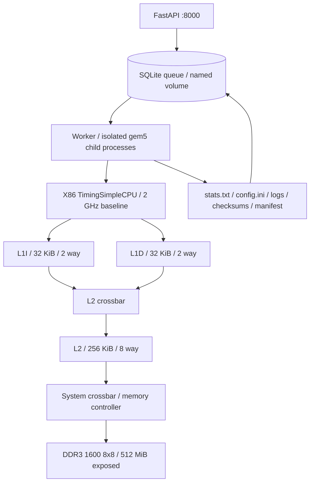

# CPU Cache & Memory Performance Analysis Platform

An incremental gem5 architecture laboratory with a React/TypeScript dashboard,
FastAPI and SQLite experiment service, and a separate native-host gem5 worker.
Configure TimingSimpleCPU or O3CPU, private instruction/data L1 caches, unified
L2 and DDR3. Run six deterministic C workloads, inspect real counters and logs,
compare architectures, queue parameter sweeps and explore constrained Pareto
frontiers. An original C++ LRU trace model provides an independent cross-check.

No substitute performance statistics are generated. See the
[validation record](docs/PROGRESS.md) for the exact tested scope and remaining
limitations; source availability alone does not establish simulator success.

## Repository structure

```text
backend/app/       FastAPI, schemas, SQLAlchemy, worker, runner, metric parser
frontend/          React, TypeScript, Tailwind, React Flow, Recharts, Vitest, browser tests
simulation/se.py  gem5 embedded-Python architecture configuration
workloads/        matrix plus sequential, random, traversal, sorting, pointer workloads
cache_model/      original C++20 set-associative LRU address-trace model
tests/            parser, API, subprocess integration, workload, opt-in gem5 tests
scripts/smoke.py  HTTP-to-gem5 acceptance test
examples/         reusable baseline configuration
docs/             decisions, progress, and staged acceptance criteria
Dockerfile.*      independently cached API and simulator images
docker-compose.yml
```

## Run locally

Install and start Docker Desktop (or Docker Engine with Compose). No host gem5,
compiler, or Python packages are necessary for the services.

```sh
docker compose up --build
```

The first build compiles gem5; allow substantial build time, network access,
several GiB of disk, and at least 8 GiB allocated to Docker. The expensive gem5
layer is cached independently of application and workload sources. Do not use
`--no-cache` for routine development. The runtime worker has a 4 GiB container
memory limit, two CPUs, a 128-process limit, and defaults to one simulation at a
time. Build-time resource use is controlled by `BUILD_JOBS` (default 2), not the
runtime limits. Increase Docker's memory if the compiler is killed.

Compiler objects use a persistent BuildKit cache keyed by gem5 version and host
architecture, so retries can reuse completed compilation work. The runtime image
receives `/opt/gem5/bin/gem5.opt` without the object cache. Keep Docker running
through the first build. Cache storage is local to the selected Docker builder;
see [Docker's cache-mount documentation](https://docs.docker.com/build/cache/optimize/#use-cache-mounts).

Open the dashboard at **<http://localhost:8080>**. The API reference is available
at <http://localhost:8000/docs> or through the dashboard's API reference link.
`GET /api/health` reports API/database health and a separate `worker_ready` flag.
API availability alone does not establish simulator readiness.

Run the real end-to-end check from another terminal (host Python 3.10+):

```sh
python3 scripts/smoke.py
python3 scripts/smoke.py --size 32
python3 scripts/smoke.py --cpu O3CPU
python3 scripts/study.py
```

The script waits for worker readiness, saves the baseline, submits a run, polls
status, checks real metrics and cache rates, and prints them. It exits with an
error and captured logs on failure. Every invocation creates a new experiment.

For manual submission:

```sh
curl -s http://localhost:8000/api/configurations \
  -H 'Content-Type: application/json' -d @examples/baseline.json
# Copy the returned id into configuration_id below.
curl -s http://localhost:8000/api/simulations \
  -H 'Content-Type: application/json' \
  -d '{"configuration_id":"REPLACE_WITH_CONFIGURATION_ID","benchmark":"matrix","size":32}'
```

Use the returned run ID with `/api/simulations/{id}`, `/metrics`, and `/logs`.
`POST /api/simulations/{id}/cancel` cancels queued or running jobs. `/metrics`
returns HTTP 409 until a simulation has completed successfully.

## What the architecture demonstrates



TimingSimpleCPU is a timing-aware simple in-order model. Cache misses stall
execution through the classic cache hierarchy and memory controller. This is
not a model of a specific commercial processor, and x86 instructions can have
different micro-operation costs. IPC is committed architectural instructions
divided by the CPU cycle counter, not gem5's simulated host throughput.

A set-associative cache maps each line to a set with a bounded number of ways.
This implementation explicitly selects LRU replacement, uses no prefetcher, and
validates power-of-two capacities and set counts. Line size, associativity,
capacity and latency can be changed. The latency parameter sets each cache's
tag, data and response latency in clock cycles; it is not a universal end-to-end
hit latency. Crossbars, misses, fills, queueing and DRAM timing also contribute.
CPU, caches, crossbars and the memory controller share the configured system
clock domain. Frequency changes therefore affect this synchronous fabric as well
as the CPU; DDR3 device timing parameters remain those of the selected model.
This is not an isolated CPU-frequency experiment with fixed fabric clocks.
Clock periods are quantized to the 1 ps simulator tick; inspect the saved
`config.ini` for the resulting period when a frequency is not exactly representable.

The matrix uses a deterministic i-j-k traversal: rows of A and columns of B.
Column traversal produces a stride of `n * sizeof(uint64_t)` in B. Changing the
working set, line size and associativity can change compulsory, capacity and
conflict behavior. A larger cache does not guarantee better execution time:
latency changes, working-set fit, and the bottleneck matter. The later exploration
milestone must test that claim rather than impose monotonic results.

## Measurements and correctness

The workload initializes `A[i,k]=i+k+1` and `B[k,j]=2*k+j+1`, multiplies into
64-bit integer C, and checks **every** result against a closed-form sum. The host
runner also verifies the final checksum. Dimensions 2..128 avoid integer
overflow and bound the workload. Compilation uses an x86-64 baseline, static
linking, non-PIE, `-O2`, and disabled tree vectorization; it never uses `-march=native`.

The platform measures the **whole process**, including libc startup, allocation,
initialization, multiplication, validation and output. There are no ROI markers
or warm-up resets. Do not interpret this as isolated multiplication latency.
Syscall emulation does not model an operating system, scheduling or full-system
effects. Only one core and one memory type are supported. Address ranges of
128, 256, 512, 1024 and 2048 MiB are selectable; changing the exposed range does
not change the DDR3 device's bank organization or timing model. O3CPU uses gem5's
default out-of-order pipeline parameters; it is not a calibrated commercial CPU.
The DDR3 device's
physical organization can be larger than the 512 MiB exposed address range;
gem5 may report that distinction as a warning.

The version-aware parser accepts only gem5 **25.1.0.1**, uses the final complete
statistics dump, and rejects truncated output. Each metric records its exact
counter/expression and engineering unit. Missing, negative, infinite or NaN
counters become JSON `null` with a reason, never a made-up zero. Simulated time
uses `simSeconds`; `wall_seconds` is separately labeled orchestration runtime.
Cache rates use `overallMissRate::total` (ratios 0..1), including demand and
non-demand cache activity as defined by gem5, not a synthetic demand-only rate.

DRAM latency is the average **read burst** service/queue delay reported by
`avgMemAccLat`, converted from ticks using `simFreq`. It is not CPU load latency.
Bandwidth is `(dramBytesRead + dramBytesWritten) / simSeconds`, in B/s. This avoids
ambiguous MB/MiB labels on simulator-provided bandwidth formulas. Traffic may
include writebacks and runtime activity. No individual memory transactions are
reconstructed from aggregate counters.

## Persistence and operational behavior

The API and simulation worker run as UID 10001 and share the `experiments` named
volume. The frontend uses an unprivileged nginx image and does not mount results. Each
run stores an immutable architecture snapshot, command, simulator version,
workload/script SHA-256, logs, raw gem5 files and parsed metrics. SQLite uses WAL
and a busy timeout; claims and admission are transactional. The worker owns an
exclusive volume lock, supports 1..4 concurrent child processes, and marks
interrupted running jobs failed on restart. Queued jobs survive restarts.
Do not scale the worker service into multiple scheduler containers.

```sh
WORKER_CONCURRENCY=2 SIMULATION_TIMEOUT_SECONDS=300 docker compose up --build
docker compose logs -f worker
docker compose down                 # preserves results
```

Default per-run limits are 120 seconds host runtime, 10 billion simulation ticks
(10 ms at the explicitly configured 1 THz tick frequency), and an 8 MiB output
budget checked periodically. These limits can fail large runs; failure produces
logs and no published success metrics. Cancellation/timeout terminates the
process group and escalates to SIGKILL after two seconds. Limits are best-effort
between polling intervals; container limits bound aggregate worker resources.
An abrupt hard kill may leave partial files; these are never treated as completed
results. There is no global retention quota yet; remove old experiment volumes
only when their contents are no longer needed. This is a local development API
bound to loopback with no remote authentication or arbitrary workload upload.

### Apple Silicon

The simulator builds for the container's native host architecture (arm64 on
Apple Silicon), while the benchmark uses `x86_64-linux-gnu-gcc` explicitly.
gem5 interprets the guest ISA: the simulator binary and the simulated workload
do not need the same host ISA. No KVM CPU is used. This avoids an extra layer of
amd64 emulation. A source-compatible amd64 fallback is supplied:

```sh
docker compose -f docker-compose.yml -f compose.amd64.yml up --build
```

That fallback requires Docker Desktop amd64 emulation on Apple Silicon and can
be substantially slower. Consult PROGRESS.md for platforms actually validated;
no native hardware performance claims follow from simulator host architecture.

## Tests

```sh
python3 -m venv .venv
.venv/bin/pip install -r requirements-dev.txt
.venv/bin/pytest -q
.venv/bin/ruff check backend simulation tests scripts
cd frontend
npm ci
npm test
npm run build
npx playwright install chromium
npx playwright test   # running Compose app required; uses the actual API
```

Host tests cover units, final-dump handling, absent counters, malformed configs,
API persistence, atomic claims, cancellation, failure, timeout, output budgets
and native benchmark correctness. Subprocess integration tests use an explicitly
synthetic test executable, never advertised as gem5 evidence. The real simulator
test is opt-in:

```sh
# Inside an environment with the pinned simulator and compiled x86 benchmark:
RUN_GEM5_TESTS=1 GEM5_BINARY=/opt/gem5/build/X86/gem5.opt \
  MATRIX_BINARY=/opt/workloads/matrix .venv/bin/pytest -m gem5 -v
```

The Docker acceptance path is `docker compose up --build` followed by
`python3 scripts/smoke.py`; it exercises the separate API and worker together.

## Workloads and reproducible exploration

| Benchmark ID | Size unit | Algorithm and correctness |
| --- | --- | --- |
| `matrix` | dimension, 2..128 | Integer i-j-k multiply, every output checked against a closed-form sum |
| `sequential` | elements, 2..262144 | Ascending contiguous reads, closed-form checksum |
| `random` | elements | Fixed-seed xorshift32/Fisher-Yates permutation, one visit per element |
| `traversal` | elements | 64-element stride passes covering all offsets, checksum |
| `sorting` | elements | Reverse input, libc qsort, every ascending element checked |
| `pointer` | elements | Fixed-seed permutation linked into a cycle; dependent traversal, checksum and cycle closure |

```sh
python3 scripts/smoke.py --benchmark sequential --size 4096
python3 scripts/smoke.py --benchmark random --size 4096
python3 scripts/smoke.py --benchmark traversal --size 4096
python3 scripts/smoke.py --benchmark sorting --size 4096
python3 scripts/smoke.py --benchmark pointer --size 4096
```

All memory workloads also initialize permutation/order buffers. With whole-process
measurement this shared setup can dominate tiny inputs. Random and pointer tests
traverse a permutation once, rather than sampling with replacement. Pointer
chasing uses index links to enforce dependent address generation. Array traversal
uses a 512-byte stride for 64-bit elements. Sorting depends on the pinned image's
libc, whose OS package revision can change; binary hashes identify each build.

The Design Space Explorer accepts up to four values each for L1D size, L2 size
and L1 associativity. Duplicate values are removed; invalid geometry rejects the
whole request before inserting jobs. The queue admits at most 100 active jobs,
and a sweep has at most 64 combinations. Experiment progress counts terminal
jobs, including failures. Pareto analysis minimizes **total L1I+L1D+L2 KiB** and
**execution cycles**, under an optional capacity constraint. Tied points remain
nondominated. Feasibility never substitutes for successful measurements.

Comparisons require the same benchmark and input size. Percent differences use
the first selected run as baseline and remain unavailable for a zero or missing
baseline. Performance charts filter by benchmark/input cohort; multiple other
parameters may differ, so the charts alone do not establish causality. History
shows the latest 200 runs; API `limit`/`offset` supports older history.

`scripts/study.py` executes both cache configurations on all six workloads and a
two-point sweep. It writes actual snapshots, metrics and comparisons to
`build/study.json`. It does not assert that more cache improves every workload.
Repeat with larger, timeout-appropriate sizes before making architecture claims.

## Original C++ cache model

```sh
cmake -S cache_model -B build/cache-model
cmake --build build/cache-model
build/cache-model/cache_model 128 64 2 examples/locality.trace
# Equivalent CLI inside the worker:
docker compose exec worker /opt/workloads/cache_model 128 64 2 /app/examples/locality.trace
python3 scripts/generate_trace.py sequential --size 4096 > build/sequential.trace
build/cache-model/cache_model 32768 64 2 build/sequential.trace
```

Without CMake, compile directly with a C++20 compiler:
`c++ -std=c++20 -O2 cache_model/cache_model.cpp -o build/cache_model`.

The model maps `floor(address / block_bytes) % sets` to a set and maintains
explicit MRU-to-LRU order per set. Tests cover compulsory, spatial, conflict and
capacity effects, LRU eviction, invalid geometry and an empty trace. The supplied
eight-address trace has **2 compulsory misses and 6 hits**, an analytical result,
not a gem5 measurement. A single aligned sequential pass over `n` 64-bit elements
has `ceil(n*8/block_bytes)` compulsory line misses in this idealized model.

To compare a generated trace against an actual run, first download the run's
`stats.txt` from the workspace, then run:

```sh
python3 scripts/cache_crosscheck.py --model build/cache-model/cache_model \
  --trace build/sequential.trace --stats build/stats.txt \
  --capacity 32768 --block 64 --ways 2
```

Use identical cache geometry and an appropriate workload size. The report retains
both predictions and real counters and explicitly labels the **scope mismatch**:
the trace is idealized data-only virtual addresses, while gem5 counts whole-process
physical-cache accesses, including setup, stack, libc, writes and timing effects.
The model has no instruction cache, TLB, MSHRs, coherence, writebacks, timing or
DRAM controller. Numerical disagreement is expected and is not proof either model
is incorrect. No matching gem5 transaction trace or isolated ROI is claimed.

Raw `stats.txt`, `config.ini`, architecture, metrics and manifests are downloadable
through `/api/simulations/{id}/artifacts/{name}` with an explicit filename allowlist.
Phase 1 result volumes receive an additive `experiment_id` column migration.

## Reproducibility and references

gem5 is pinned to tag `v25.1.0.1`, commit
`c8222cc67a399bfc01e8658dd14b30d5bfd634f9`; the Docker build checks the commit.
Application dependencies are pinned; base image tags and OS package repositories
can still receive updates, so builds are version-pinned rather than fully
bit-for-bit reproducible. Preserve image digests for a published study.

The integration was checked against the official
[two-level configuration](https://github.com/gem5/gem5/blob/v25.1.0.1/configs/learning_gem5/part1/two_level.py),
[cache parameters](https://github.com/gem5/gem5/blob/v25.1.0.1/src/mem/cache/BaseCache.py),
[cache statistics](https://github.com/gem5/gem5/blob/v25.1.0.1/src/mem/cache/base.cc),
[CPU statistics](https://github.com/gem5/gem5/blob/v25.1.0.1/src/cpu/base.cc), and
[DRAM statistics](https://github.com/gem5/gem5/blob/v25.1.0.1/src/mem/dram_interface.cc).
Current architectural guidance is available in the official
[gem5 documentation](https://www.gem5.org/documentation/) and
[cache tutorial](https://www.gem5.org/documentation/learning_gem5/part1/cache_config/).

See [engineering decisions](docs/DECISIONS.md) and [milestone plan](docs/PLAN.md).
